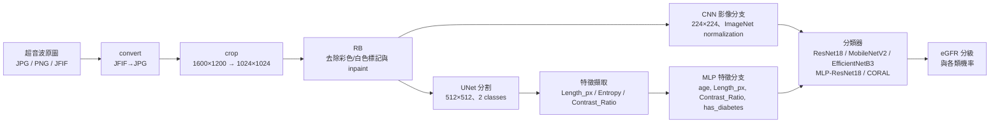
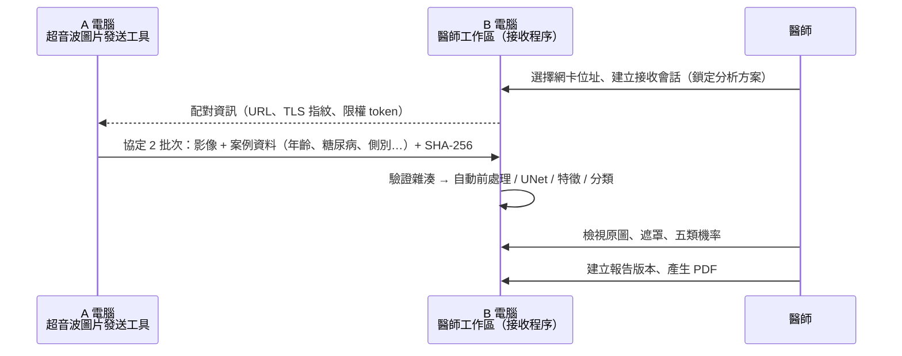

# Ultrasound-based eGFR Category Prediction（腎超新）

以**腎臟超音波影像**預測 **eGFR（估算腎絲球過濾率）分級**的本機 AI 研究平台。系統整合影像前處理、UNet 腎臟分割、影像特徵擷取、深度學習分類模型訓練／評估／推論，以及「A 電腦傳圖 → B 電腦自動分析 → 醫師產出報告」的雙機臨床示範流程。

> [!WARNING]
> **本專案為研究原型，不構成醫療診斷。** AI 輸出的類別與機率是「模型預測機率」，不是 CKD 確診、分期或已驗證的醫療效能；不能取代專業醫療人員判斷。第二台設備、真實超音波擷取卡、CUDA 及臨床適用性尚未經外部驗證。

> [!IMPORTANT]
> **本儲存庫只包含程式碼與文件。** 所有超音波影像、病人 metadata、訓練權重（`.pth`）、SQLite 資料庫、醫師報告 PDF、驗證報告與憑證金鑰都**沒有**上傳，詳見[隱私與資料保護](#隱私與資料保護)。

---

## 目錄

- [專案特色](#專案特色)
- [eGFR 分類定義](#egfr-分類定義)
- [AI 處理流程](#ai-處理流程)
- [系統架構：三區設計](#系統架構三區設計)
- [雙機傳輸與醫師報告流程](#雙機傳輸與醫師報告流程)
- [技術棧](#技術棧)
- [目錄結構](#目錄結構)
- [安裝與啟動](#安裝與啟動)
- [測試與驗證](#測試與驗證)
- [版本歷史](#版本歷史)
- [隱私與資料保護](#隱私與資料保護)
- [已知限制](#已知限制)
- [貢獻者](#貢獻者)

---

## 專案特色

- **完全本機執行**：服務只綁定 `127.0.0.1`，不含第三方追蹤，不會自動上傳任何影像或病人資料。
- **端到端影像 AI 流程**：格式轉換 → 裁切 → 去除標記（RB）→ UNet 遮罩 → 特徵擷取 → 分類推論。
- **多種分類模型**：ResNet18、MobileNetV2、EfficientNetB3、MLP-ResNet18（影像＋臨床特徵），支援 CORAL 序位分類。
- **二／三／五分類**：每種分級方案使用各自的權重與 `train_stats`，不混用結果。
- **可追溯的訓練**：背景訓練、SSE 即時監控、安全停止與 checkpoint 恢復、真正的 K-fold cross-validation、固定 seed 與分層切割（同一 SHA-256 影像不跨分割）。
- **模型評估與管理**：模型匯入／啟用／封存、指定 checkpoint 的評估紀錄、評估比較與匯出（JSON／CSV）。
- **醫師工作區**：病人／檢查管理、不可變分析 run、報告版本（v1／v2 模板）、PDF 產生與作廢、生命週期與稽核紀錄。
- **雙機示範傳輸**：A 電腦用「超音波圖片發送工具」經 TLS 傳圖，B 電腦自動依預設方案分析。
- **安全設計**：一次性挑戰＋八小時本機會話、CSRF、Host／Origin 檢查、ZIP Slip 防護、`torch.load(weights_only=True)`、日誌不記錄病人資料。

## eGFR 分類定義

固定類別索引（`02_主程式碼/backend/app/ml/contracts.py`）：

| 方案 | 類別 0 | 類別 1 | 類別 2 | 類別 3 | 類別 4 |
|---|---|---|---|---|---|
| 五分類 | eGFR < 15 | eGFR 15–29 | eGFR 30–59 | eGFR 60–89 | eGFR ≥ 90 |
| 三分類 | eGFR < 30 | eGFR 30–59 | eGFR ≥ 60 | | |
| 二分類 | eGFR < 60 | eGFR ≥ 60 | | | |

二分類使用單一 logit + sigmoid（`> 0.5` 判為類別 1）；三／五分類依序位類別輸出 softmax 機率。

## AI 處理流程



| 步驟 | 說明 |
|---|---|
| 前處理 | `convert`、`crop`、`rb`、`assort` 可自選順序；一律在工作副本進行，不改原圖 |
| UNet 遮罩 | 3-channel RGB、512×512、`base_c=32`、bilinear upsampling；argmax 後保留最大連通區並做形態學修整 |
| 特徵 | 最大元件長軸長度（`Length_px`，像素值，**不是**實體腎長）、GLCM entropy、ROI／背景環帶對比（`Contrast_Ratio`） |
| 分類 | `OnlyIMG`（純影像）與 `MLP`（影像 + 年齡、糖尿病等特徵）兩種模式，各支援二／三／五分類 |

Feature CSV 固定欄位：`image_name,age,gender,Length_px,Entropy,Contrast_Ratio,has_diabetes`（UTF-8 BOM）。MLP 實際輸入順序固定為 `age,Length_px,Contrast_Ratio,has_diabetes`。

## 系統架構：三區設計

單一 FastAPI 後端（loopback）同時服務三個區域，共用研究資料庫、醫師資料庫與運算資源協調器：

| 區域 | 路由 | 功能 |
|---|---|---|
| 工作區（研究） | `/research` | 資料集匯入、影像處理、遮罩、特徵、訓練設定、AI 推論、AI 判斷 |
| 模型區 | `/model-center` | 訓練監控、模型管理、模型評估、醫師端封存分析方案 |
| 醫師工作區 | `/clinical` | 設備與雙機接收、病人／檢查、不可變分析、報告、PDF、紀錄與回收 |

資料位置由 `workspace-layout.json` 決定，優先順序為：環境變數 > 根目錄 `.env` > `workspace-layout.json`。缺少既有資料庫時系統會拒絕啟動，而不是建立空資料庫。

完整 API 契約、遷移與回復流程見 [`01_Codex/三區改版_架構_API與回復手冊.md`](01_Codex/三區改版_架構_API與回復手冊.md)。

## 雙機傳輸與醫師報告流程



- 接收程序為獨立 TLS 程序，只開放批次上傳，不暴露研究／病人／模型管理 API。
- 病人資料只存於醫師資料庫，不寫入 URL、配對檔、錯誤訊息或日誌。
- 示範案例一律標記為 `demo`，報告保留「示範／非正式診斷書」標示。

## 技術棧

| 層級 | 技術 |
|---|---|
| 後端 | Python 3.11／3.12、FastAPI 0.116、Pydantic 2、SQLAlchemy 2、Alembic、SQLite |
| AI / 影像 | PyTorch 2.6.0 + torchvision 0.21.0、OpenCV、scikit-image、scikit-learn、NumPy、Pillow |
| 前端 | React 18.3、TypeScript 5.7、Vite 6、Tailwind CSS 3.4、React Router 6、Recharts |
| 報告 | ReportLab（PDF）、pypdf（測試） |
| 測試 | pytest、Vitest、Testing Library、ESLint |
| 部署 | Windows 一鍵 `setup.bat` / `start.bat` / `stop.bat`；選配 Docker Compose |
| 介紹影片 | HyperFrames（HTML 動畫合成）、Edge TTS 台灣華語配音 |

## 目錄結構

```text
.
├── README.md                    本文件
├── setup.bat / start.bat / stop.bat   根目錄啟動器（轉交 02_主程式碼）
├── workspace-layout.json        各資料區位置設定
├── .env.example                 環境變數範例（不含任何密鑰）
├── 01_Codex/                    工程文件：架構、API、操作、驗收對照、歷史摘要
├── 02_主程式碼/
│   ├── backend/app/             FastAPI：api、clinical、ml、db（Alembic 遷移）、core
│   ├── backend/tests/           後端 pytest 測試
│   ├── frontend/src/            React 前端（research / model-center / clinical）
│   ├── photo_process/           原始影像前處理工具（crop、RB、assort、k-fold…）
│   ├── unet/                    UNet 分割模型與遮罩產生
│   ├── resnet/                  原始分類訓練、CORAL、推論與模型管理程式
│   ├── features/                特徵擷取與 metadata 整理工具
│   ├── tools/image_sender/      A 電腦「超音波圖片發送工具」原始碼
│   ├── scripts/                 啟停、備份／回復、升級、驗證腳本
│   └── app.py                   舊版桌面入口（保留相容）
├── 03_模型與影像資料/            ⛔ 本機資料區（影像、權重、資料庫）— 不上傳
├── 04_醫師報告/                  ⛔ 報告 PDF — 不上傳（僅保留說明）
└── 05_介紹影片/                  介紹影片的 HyperFrames 合成原始碼（截圖與成品不上傳）
```

## 安裝與啟動

### 系統需求

- Windows 10／11 64-bit
- Python 3.11 或 3.12（64-bit）
- Node.js 20.19 以上（建議 22 LTS），透過 corepack 使用 pnpm
- 建議 16 GB RAM 以上；CPU 模式不需 NVIDIA GPU

### 一鍵安裝

```bat
git clone https://github.com/chenpin12345/Ultrasound-based-eGFR-category-prediction.git
cd Ultrasound-based-eGFR-category-prediction
setup.bat
```

`setup.bat` 預設安裝 PyTorch CPU wheel。若要使用 CUDA：

```bat
set ISU_TORCH_VARIANT=cu124
setup.bat
```

（亦支援 `cu126`）

### 準備資料與模型

本儲存庫不含資料與權重。首次使用前請建立 `workspace-layout.json` 所列的資料夾，並透過介面自行匯入**經授權且已去識別化**的影像與可信的 `.pth` 權重：

```text
03_模型與影像資料/research/data      研究資料庫與資料集
03_模型與影像資料/research/models    分類／UNet 權重
03_模型與影像資料/clinical           醫師資料庫、影像與封存方案
03_模型與影像資料/runtime            執行期狀態
04_醫師報告                          受管理的 PDF
```

> `workspace-layout.json` 預設 `"require_existing_databases": true`，找不到既有資料庫時會拒絕啟動（避免誤建空資料庫蓋過遷移後的資料）。**全新環境第一次啟動前**，請把它改成 `false`，讓系統建立並遷移空的研究／醫師資料庫；建立完成後建議改回 `true`。備份與回復方式見 [`01_Codex/操作與交付說明/workspace-operations.md`](01_Codex/操作與交付說明/workspace-operations.md)。

### 日常使用

```bat
start.bat
```

瀏覽器會開啟 `http://127.0.0.1:8000`；結束時執行 `stop.bat`（只會停止本專案的服務程序）。API 互動文件位於 `http://127.0.0.1:8000/api/docs`。

### A 電腦發送工具

原始碼在 `02_主程式碼/tools/image_sender/`，可用以下指令打包成免安裝版（打包產物不納入版本控制）：

```powershell
02_主程式碼\scripts\build_image_sender.ps1
```

## 測試與驗證

```bat
cd 02_主程式碼
.venv\Scripts\python.exe -m pytest backend\tests -q

cd frontend
corepack pnpm run lint
corepack pnpm run typecheck
corepack pnpm run test
corepack pnpm run build
```

最近一次本機驗收（2026-10-11／10-13）：後端 237 項、前端 65 項通過；59 份分類權重在相同 CPU 輸入下前後版本的標籤一致、機率最大差異 0。這些是**程式一致性**驗證，不是獨立測試集準確率；原始海報成績**尚未驗證重現**。詳見 [`01_Codex/三區改版_驗收對照表.md`](01_Codex/三區改版_驗收對照表.md)。

## 版本歷史

每個版本都以 Git tag 標記，可用 `git checkout <tag>` 切換查看：

| Tag | 日期 | 來源資料夾 | 主要內容 |
|---|---|---|---|
| [`v0-original`](../../tree/v0-original) | 2026-08-03 | `腎超_Original` | ISU AI KUA 腎功能影像研究平台初版：FastAPI + React、資料集管理、前處理、UNet、特徵、五類訓練（含 K-fold、CORAL）、批次推論 |
| [`v1`](../../tree/v1) | 2026-09-22 | `腎超_V1` | 接入 975 張原圖流程、59 份分類權重 + UNet 登錄與一致性驗證；新增 AI 判斷（MLP／OnlyIMG × 二／三／五分類）；圖庫與疊圖；效能最佳化（見 `AI_JUDGMENT.md`、`INTEGRATION.md`、`PERFORMANCE.md`） |
| [`v2`](../../tree/v2) | 2026-10-16 | `腎超新`（現行） | 四區目錄重構；三區（工作區／模型區／醫師工作區）改版；本機會話安全模型；模型評估；不可變分析與報告 v2／PDF 管理；雙機接收協定 2、預設方案與案例資料；備份／回復工具；介紹影片 |

```bash
git log --oneline --decorate   # 查看版本
git checkout v1                # 切換到 v1
git diff v1 v2 --stat          # 比較兩版差異
```

> 舊版本同樣只保留程式碼與文件；各版的 `data/`、`models/`、`integration-reports/`、metadata CSV／XLSX 均未上傳。

## 隱私與資料保護

本專案涉及病人醫療影像，上傳前已逐檔檢查，**以下內容一律排除**（`.gitignore` 亦已設定防止誤傳）：

| 排除內容 | 原因 |
|---|---|
| 超音波原圖、處理圖、遮罩（`*.jpg`、`*.png`…） | 原始影像頂端含姓名、病歷號、醫院、日期等個資 |
| metadata／特徵 CSV、XLSX | 含年齡、糖尿病、HbA1C、eGFR 等病人資料 |
| SQLite 資料庫 | 含病人、檢查、報告與稽核紀錄 |
| 醫師報告 PDF | 病人檢查報告 |
| 模型權重 `.pth` | 由病人資料訓練而得，且檔案龐大 |
| 驗證報告、截圖、日誌、執行期檔案 | 可能含影像、病人數量統計與本機路徑 |
| TLS 憑證與私鑰（`*.pem`）、加密檔 | 安全性 |
| 介紹影片截圖與 MP4 成品 | 畫面含真實超音波影像 |
| 本機絕對路徑 | 文件中的使用者路徑已替換為 `<專案根目錄>` |

若要使用本系統，請自行準備**經 IRB／資料提供者授權且已去識別化**的資料，並僅在本機處理。

## 已知限制

- 研究原型，未經臨床驗證；AI 機率不代表準確率。
- 固定的 crop／RB 幾何與原始超音波設備版面高度相關，其他設備的影像需先以少量樣本驗證。
- `Length_px` 為像素特徵，報告不提供 mm／cm 換算。
- SQLite + ThreadPool 適合單機本機使用，不是分散式訓練平台。
- 前端主 bundle 約 889 kB（gzip 265 kB），大小警告保留。
- 第二台 Windows 設備、真實超音波擷取卡、CUDA 尚待實機驗證。

## 貢獻者

- [@chenpin12345](https://github.com/chenpin12345)

本專案僅供學術研究與教學使用。
